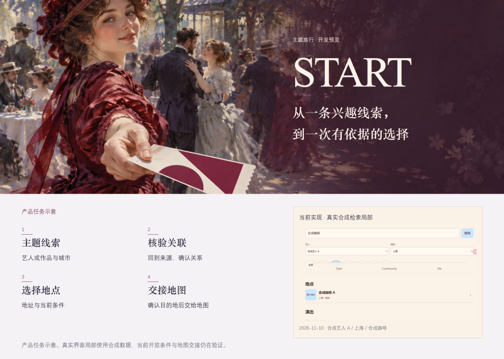
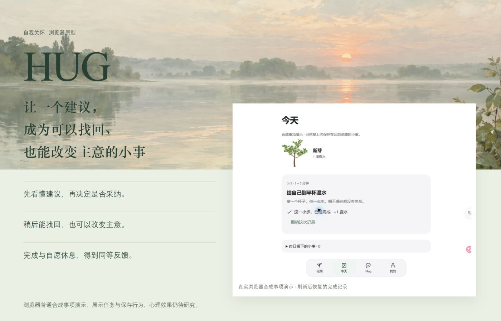

# START / HUG 产品案例图文方案

状态为设计评审稿。内容依据 2026-11-11 主内容包，2026-11-12 完成排版精修与验收。正式交付目录为 `site-v4/public/product-cases-2026-11-11/`。先打开该目录的 `index.html`，可进入两份连续案例、两份竞品分析和两张可编辑主图。

## 面试官的阅读路径

展厅和作品目录承担找到项目的任务。进入项目后，首屏直接给产品定位、我的职责和目前阶段，接着用介绍图建立功能轮廓。连续正文沿场景、核心路径、产品取舍、竞品判断、运营评价和当前证据推进。页内目录允许跳读，详细竞品分析独立成页，工程验收范围放入可展开区域。

现有 `site-v4/start.html`、`hug.html` 已更新职责、阶段与证据入口，镜片/球面目录仅更新 START/HUG 简介。本轮提议的图文布局通过“完整产品案例图文方案”进入，保留待评审标记。旧页面的其余叙事属于此前方案，正式替换为本轮连续案例的决定交由用户视觉评审。

正常入口为 `http://127.0.0.1:4184/works.html`。图文方案总览为 `http://127.0.0.1:4184/public/product-cases-2026-11-11/index.html`。当前镜片/球面入口为 `http://127.0.0.1:4196/reference/eye-reflection/index.html`，可从直达目录进入。两种服务下，案例、竞品与作品速览使用相对链接。方案内“返回展览”回到原 `index.html#start` 或 `#hug`，浏览器返回可沿访问记录回到球面。把页内返回入口直接恢复到球面原朝向，留作后续整合决定。

## 画面、文字与布局

START 使用酒红、墨紫与浅纸色，沿用递票舞会原画。HUG 使用鼠尾草绿、深绿与晨间水面。两个案例共享阅读网格与导航，标题、图像和语气由各自产品内容决定。中文展示字使用现有宋体风格，正文用等线/雅黑等细无衬线回退，英文产品字使用衬线。当前实现为系统字体栈，跨系统字形与字体授权尚需在正式发布前核对。

桌面案例上方为原画与摘要并置，下方为介绍图、左侧阅读导航和连续正文。正文默认 15px、1.85 倍行高，主要段落保持自然连贯。竞品分析先给任务和四步路径，再给逐步对照表、判断和来源。内容页采用静态阅读，锚点可直接到达，各段不依赖自动播放或画面加载结束。

介绍图为可编辑 HTML 画板加实际导出 JPG。START 尺寸 1400×1000，HUG 为 1400×900。图片是本轮版式提案，系统字体和原始素材细节仍接受视觉评审。源 HTML 能继续修改文字、位置和配色。

### START 介绍图

上部保留原画完整的递票动作，标题在右侧暗部。副标题固定为“从一条兴趣线索， / 到一次有依据的选择”两行。下方左侧将主题线索、核验关联、选择地点和交接地图排成四步，第四步说明为“确认目的地后交给地图”。右侧两个窗口裁切同一张真实合成检索截图，分别呈现查询条件和结果，来源仍保存完整原图。底部交代当前开放条件与地图交接仍在验证。

### HUG 介绍图

左侧标题分为“让一个建议， / 成为可以找回、 / 也能改变主意的小事”，下方三段解释选择、找回与温和反馈。右侧将刷新后恢复的真实普通合成事项截图放在白色底板上，底部明确演示行为与心理效果研究的阶段。原截图内的小型翻译控件属于取证画面的一部分，保留原文件与来源说明。画板外层翻译控件只在两张导出页清理，未修改原截图。

## 四个阅读阶段与素材

| 阶段 | 本轮呈现与责任 | 实际素材 |
| --- | --- | --- |
| F0 可理解的项目入口 | 首屏写清产品、职责、阶段与阅读入口，HTML 负责可读信息 | 既有 START/HUG 原画，原页内容字段 |
| F1 产品轮廓 | 介绍图将产品任务与真实界面配对，文字可编辑 | START 原画及真实合成检索局部，HUG 原画及刷新恢复截图 |
| F2 形成判断 | 连续正文说明用户困难、功能路径、规则取舍，竞品页沿同一任务比较 | 已审核主内容包、任务示意、来源变化修复、采纳与保存恢复案例 |
| F3 深入核对与返回 | 真实截图、来源链接与工程范围可追问，普通链接回到案例、目录或展览 | START 七态设计提案，HUG 保存失败与最高阶段截图，官方资料与测试范围 |

本轮全部图像来自既有项目资产和已记录演示。原画约 1672 像素宽，本轮以静态阅读和 1400 像素导出使用，超大屏放大清晰度继续属于素材审核项。人物移开后的补背景、额外观看角度和分层接触关系需要独立素材审核。本轮图文方案采用现有完整画面，不作资产齐备判断。

`asset-manifest.json` 记录七份源素材、字节数及 SHA256，`export-manifest.json` 记录研究截图、两张最终主图和页面编排截图的复制指纹。主要艺术资产为 `start-art.webp`、`hug-art.webp`，界面证据为 `start-search.png`、`hug-returned.jpg`、`hug-failure.jpg`、`hug-highest.jpg`。`start-states.png` 在可展开区域明确标为设计提案。

## 文案与结论的范围

START 强调主题目录的关联依据、当前条件与内容维护。成都 9 组线索、2 个地图候选、0 个近期可发布地点解释实际核查结果。来源字段合同已有对应工程验收，新表单、审核日期与当前开放状态合同、云部署和真机地图交接继续待验。职责写需求、范围、业务规则、AI 协作推进与结果审阅。AI 辅助检索、候选整理、实现和回归。

HUG 强调低参与门槛、预览、拆小、主动采纳、Today 与自愿休息。真实浏览器演示使用普通合成事项，已验证刷新恢复行为。8 张专业相关卡片为 `draft_unreviewed`，专业审阅、真实用户、真实模型和心理效果仍待验证。本人职责按产品取舍与 AI 协作表达。已有补丁保留实现，完整可运行分支整合属于产品工程后续工作。

两个竞品页均给任务、步骤、当前范围与资料来源。厂商功能说明与本项目记录分别注明归属。客户端步数、耗时、版本与地区条件继续待同任务体验。工程测试数量在深入证据中说明对应环境，用户收益继续等待观察。

## 验收与可回退保存

浏览器实际验收与文件、HTTP、素材指纹检查写入 `verification.json`。正常服务仅为本批八个页面与样式入口增加精确白名单，图片仍走既有媒体规则。新增 JPG/JPEG 类型支持真实演示与导出。链接使用普通相对地址，返回锚点能适配两种基址。正文图片使用真实来源，可延迟加载，主图可独立打开。减少动态偏好下可直接阅读。

已有本机项目包含此前尚未保存的空间与球面探索。本批使用精确清单在私有工作分支保存独立工件，同时附五个接入文件的 before/after 指纹与应用说明。该分支保存本轮可审阅图文资产和接入补丁，完整历史球面工程的云端整合范围需要按其独立基线继续核对。当前服务验收在用户本机进行，因为现有原画、取证文件和连接 Chrome 位于本机。云端保存结果记录于交付报告。

仍需用户确认的是两张主图与连续阅读版式、正式替换旧案例页的时机，以及跨系统字体是否采用授权字体文件。当前文案以主内容包为准。新项目数据与产品成效在实际观察后再补入。
