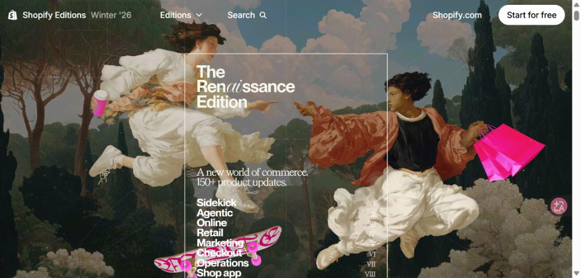
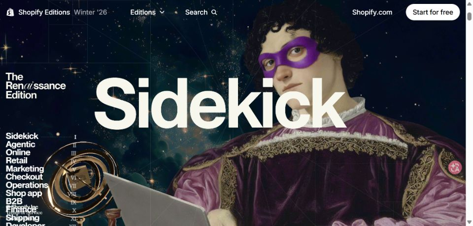
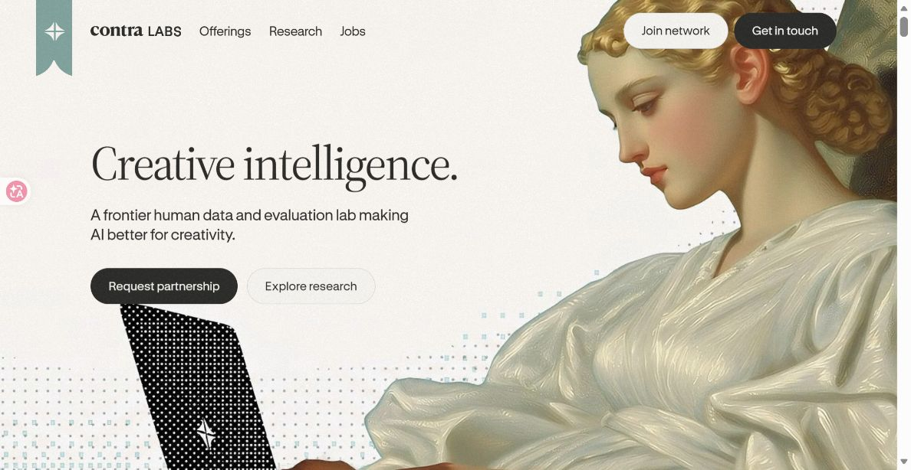
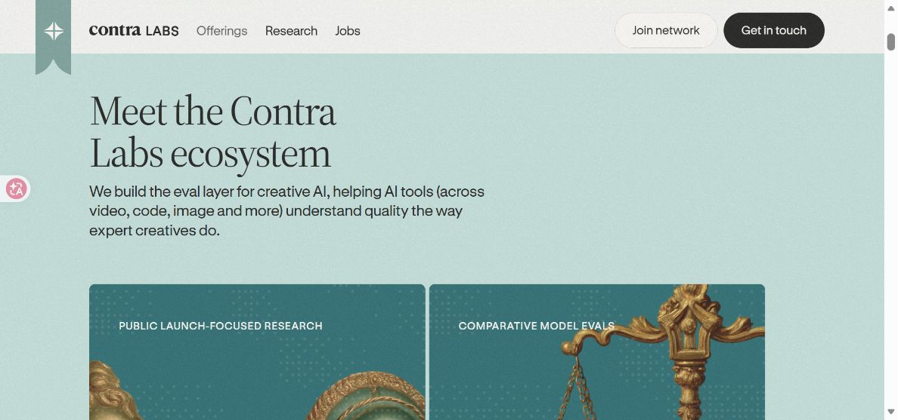

# Vagus：真实视觉研究与 Skill 2.0

2026-10-23。实际查看了两站首屏及四个内容状态，保存六张截图和一份 Contra 字体测量；不是仅阅读官网正文。结论是：之前两稿的问题不在“背景东西不够多”，而在人物尺度、字图配重与材质逻辑没有整体设计。新版本不继续给旧石像补景物，也不把参考拆成装饰清单。

## 实际画面

| 维度 | Shopify Winter ’26 | Contra Labs | 对 Vagus 的意义 |
|---|---|---|---|
| 艺术方向 | 可进入的绘画章节，时代错位贯穿全站 | 编辑页面与古典图像实验 | 先选组织方法，不混成风格清单 |
| 主视觉 | 人物动作、巨字和场景合成锚点 | 巨大人物局部、裁切和留白配重 | 石像需有足够尺度，不是旁边的小摆件 |
| 构图 | 首屏两侧动态围出中央阅读；章节允许偏心 | 左文右图首屏，主体越界，后段改为局部特写 | 不对称应有对齐和重量，不是随意散落 |
| 背景 | 自然、宇宙、建筑内景随章节变化 | 近白、青绿、绘画局部随内容切换 | 简单不等于纯底，丰富不等于加风景 |
| 古典／现代 | 人物、服饰与现代商品、设备并置 | 古典女性与网点笔记本发生动作关系 | 幽默由互动产生；Vagus 简化为一台电脑 |
| 字体 | 巨幅无衬线与衬线／书写感形成对比 | 高对比衬线标题配中性正文 | 中文须实际打样，不机械套英文字体 |
| 字图融合 | 巨字跨人物和画面层次 | 标题、留白和巨大局部形成编辑关系 | 融合不是每个标题必须被遮住 |
| 材质 | 绘画世界的光线与空间统一 | 绘画、颗粒、网点交界统一 | 图层可以分开，艺术指导不能分裂 |
| 内容与导航 | 顶部导航、章节索引维持位置感 | 固定导航、按钮、模块和统计块各有层级 | 稳定阅读系统承托视觉变化 |
| 技术／动效证据 | 制作者说明场景、时间轴和降级 | 制作者说明 Framer、预加载和滚动 | 不为模仿而堆技术，不把自述当性能测试 |

### Shopify 的三个状态

首屏的自然环境是完整绘画的一部分，人物斜向运动与现代物件围出中心阅读区；细线框、标题、目录将戏剧场景收束为可导航页面。

Sidekick 用深色星空、几何细线、绘画人物、电脑与环状天文仪器造型构成不同章节；巨大浅色标题横跨人物。这里既不要求全身，也不只有一个道具。

Agentic 使用暖暗建筑与拱／镜结构，人物和现代设备分处两侧。由此不能归纳出“Shopify 必须冷色、背景极简”的规则。

### Contra 的三个状态

首屏大面积近白微颗粒底，左侧衬线标题，右侧人物巨大裁切；绘画女性俯向网点电脑，青绿像素连接材料边界。它的张力并不来自复杂背景，更不是必须加自然景观。

Offerings 用青绿底、深色标题、深青模块和金色古典物件局部。原站确实有卡片；这属于参考事实，不覆盖 Vagus 的竖排文字要求。

missing signal 区用绘画手部特写、斜向网点物件与浅色实底大数字内容块。下图原保存名 section-entry 只是文件名，不证明已测转场。

Contra 的 DOM 采样：1206×565 视口，首屏标题 Source Serif 4 Variable、64px/400，生态标题 56px，模块标题 32px。它们是采样状态，非所有断点的设计令牌；Shopify 字体名未实测，不推断。

## 为什么之前不合理

第一版纯紫底的问题是较小完整石像、普通字与空底未形成视觉重量关系，而不是素底这个类型本身错误。第二版把自然暮景放到棚拍石像后，人物、环境与字体仍各讲各的材质和光线。“素材／UI 分离”本是交付要求，被错误执行成了独立拼装的艺术指导。

2.0 因此删除“必须前中远景、必须全身、必须冷色”的通用处方，保留非黄色等 Vagus 约束。优先下一稿为 Contra 式编辑裁切：放大偏右思想者，保留头、托腮手与电脑关系，允许裁下身；左侧标题与三行文字入口形成清楚层级；底面以一种统一材质／边缘处理连接主体。先做黑白重量稿和中文字体对照，再制作一个完整方向。若改用 Shopify 式绘画章节，则整体设计人物与环境，而非复用不匹配抠图补背景。

## 制作资料与验证边界

直接来源：[Shopify 官网](https://www.shopify.com/editions/winter2026)、[Contra Labs 官网](https://contralabs.com/)。[Contra 制作者案例](https://contra.com/p/7OWlOrXQ-contra-labs-framer-site-build)说明 Framer、定制预加载到首屏衔接及滚动动画；[Shopify 制作线程镜像](https://threadreaderapp.com/scrolly/2001335712982147307)描述 R3F 分场景、时间轴控制与降级，[参赛方案例](https://www.oneclub.org/awards/theoneshow/-award/64482/the-renaissance-edition/)补充设计开发协作。它们是制作方公开说明，不是独立代码或性能审计。完整 GitHub 成熟先例、许可证与局限见 Skill 的 sources.md；本轮不安装三维／滚动依赖。

已验证截图读取与目录锚点操作，未验证全站连续动效、帧率、精确时长、悬停全集、全部设备和响应式。Skill 的短转场参数是试制建议，不是原站实测。本轮没有生成新视觉稿，两版历史稿仍为用户否定状态。
